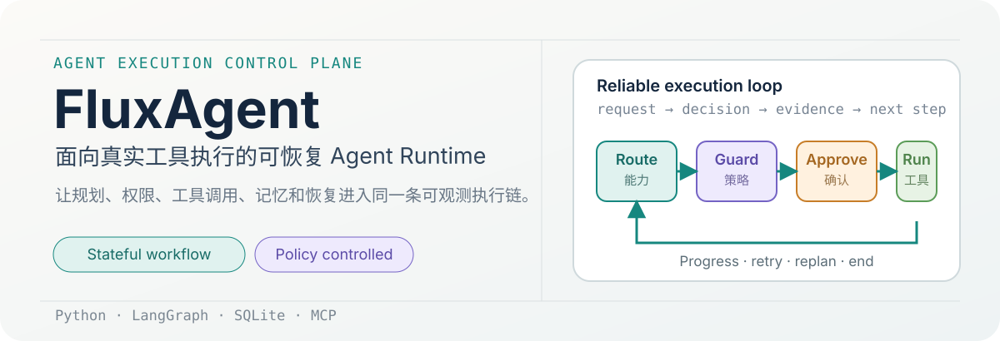
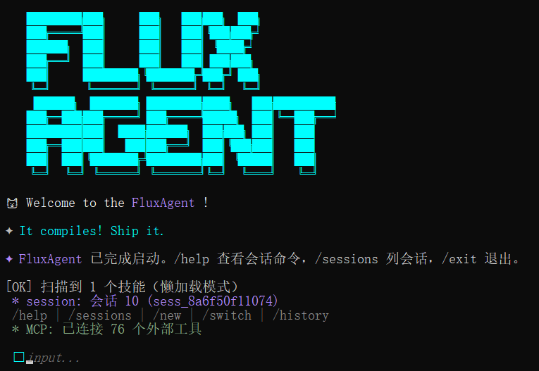
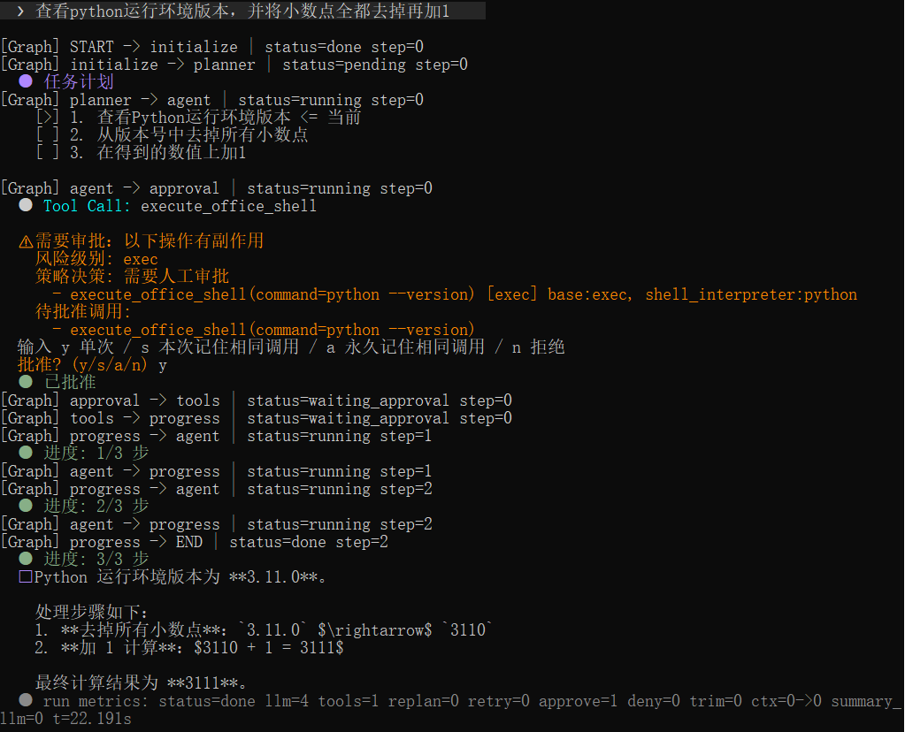
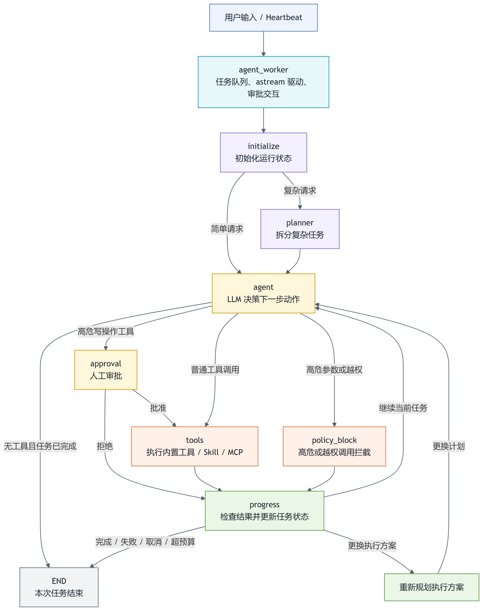
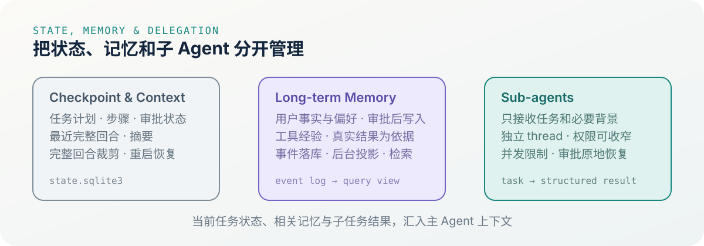
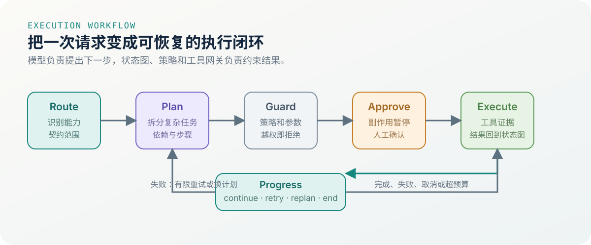
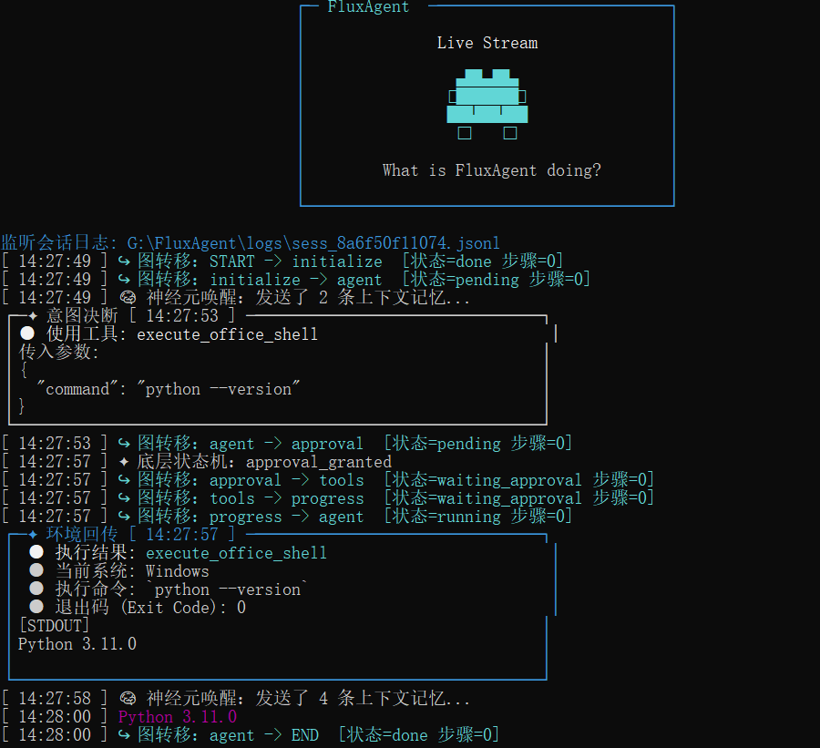

<h1 align="center">FluxAgent</h1>

<p align="center">
  <strong>面向真实工具执行的可恢复 Agent Runtime</strong><br>
  将任务规划、权限控制、人工审批、记忆管理和失败恢复放进同一条可观测执行链。
</p>

<p align="center">
  <strong>An open-source agent runtime for planning, controlled tool execution, recovery, and stateful automation.</strong>
</p>

<p align="center">
  
  
  
  
  
  
</p>
<p align="center">
  <a href="#-概述">概述</a> ·
  <a href="#-快速开始">快速开始</a> ·
  <a href="#-系统架构">系统架构</a> ·
  <a href="#-核心设计">核心设计</a> ·
  <a href="#-测试验证">测试验证</a>
</p>


<p align="center">
  
</p>

---

## 📌 概述

🔎 面向资料分析、文件处理和受控自动化任务，FluxAgent 关注四个实际问题：复杂任务如何推进、工具失败后如何恢复、外部状态变更如何审批，以及长对话如何控制上下文。

🔗 FluxAgent 将这些行为放进一张**显式的 LangGraph 状态图**中。它可以根据请求复杂度选择直接回答或先生成计划；工具调用会经过能力路由、Policy 检查和执行网关；任务失败后会分类选择重试、重新规划或结束；运行状态和对话历史通过 SQLite checkpoint 保存。

🔗 从用户请求到工具结果，FluxAgent 保留明确的执行状态和审计记录，展示当前步骤、审批原因和失败后的处理路径。

### 🌟 核心能力

- 🔄 **任务规划与执行**：简单请求直接回答，复杂请求进入 Planner → Agent → Tool → Progress 循环。
- ♻️ **失败处理**：区分瞬时错误、参数或文件错误、策略错误，分别处理 retry、replan 和终止。
- 🛡️ **执行前确认**：写操作工具进入 Human-in-the-loop（HITL），高风险参数由 Policy 直接拦截。
- 🧠 **分层状态与记忆**：工作记忆、短期上下文和长期记忆分开管理，避免把全部历史塞给模型。
- 💾 **状态可恢复**：使用 `AsyncSqliteSaver` 保存图状态，多会话通过 `thread_id` 进行隔离。
- 🧩 **Skill 与 MCP 扩展**：外部能力进入统一注册表、调用契约和安全执行链。
- 🎯 **能力路由（Tool RAG）**：显式指定优先，检索匹配外部能力后按需绑定工具；无匹配时保留内置工具，不开放全部外部工具。
- 👥 **可控子 Agent**：由主 Agent 按任务需要委派，支持上下文隔离、并发限制、超时和审批恢复。
- 🔌 **多模型适配**：统一 Provider 工厂支持 OpenAI 兼容接口，并提供 Anthropic、Ollama 适配入口。
- 💻 **运行时监控**：审计日志记录 LLM 输入、工具调用、工具结果、状态转移和系统动作。

一个典型任务如下：

```text
读取项目资料
  → 分析发布风险
  → 运行受控检查
  → 生成发布报告
  → 写入文件前请求审批
  → 保存状态并返回结果
```

## 🚀 快速开始

### **1️⃣ 安装**

```bash
git clone https://github.com/JDBSK/FluxAgent.git
cd FluxAgent

python -m venv .venv
source .venv/bin/activate       # Windows: .venv\Scripts\activate
pip install -e .
```

### **2️⃣ 配置**

有两种方式：使用交互式配置向导，或手动编辑 `.env`。

#### 方式一：配置向导

```bash
# 引导填写 Provider、模型、API Key 和 Base URL，并测试连接
fluxagent config
```

#### 方式二：手动配置

```bash
cp .env.example .env
```

至少配置模型提供商、模型名称和对应 API Key：

```dotenv
DEFAULT_PROVIDER=other
DEFAULT_MODEL=your-model
OPENAI_API_KEY=your-api-key
OPENAI_API_BASE=https://your-compatible-endpoint/v1
```

Embedding、路由重排模型和入口规划分类器都是可选配置，不影响基础运行。

OpenAI 兼容接口使用默认依赖即可运行。选择 Anthropic 或 Ollama 时，需要分别安装 `langchain-anthropic` 或 `langchain-ollama`。

### **3️⃣ 运行**

```bash
# 启动交互式 Agent 会话
fluxagent run
```

<p align="center">
  
</p>

### **4️⃣ 基本用法**

<p align="center">
  
</p>

启动后，可以直接用自然语言让 Agent 调用工具：

| 类型 | 示例 | 作用 |
|---|---|---|
| 时间查询 | `现在是北京时间几点？` | 调用安全的时间工具 |
| 数学计算 | `帮我算一下 (128+64)/4` | 调用安全计算器 |
| 文件查找 | `列出 demo 目录下的文件` | 查看工作区内容 |
| 文件读取 | `读取 demo/project_brief.md` | 获取项目资料 |
| 文件写入 | `把分析结果写入 demo/release_report.md` | 触发写入审批 |
| Shell 命令 | `运行校验脚本检查报告格式` | 进入受控命令执行 |
| 长期偏好 | `记住我更喜欢简短回复` | 提交记忆变更提案 |

CLI 会话控制命令：

| 指令 | 作用 |
|---|---|
| `/help` | 查看命令帮助 |
| `/new` | 新建并切换会话 |
| `/switch <id \| 标题>` | 切换会话 |
| `/sessions` | 列出会话 |
| `/history 10` | 查看最近历史 |
| `/notes [文本]` | 查看或追加会话笔记 |
| `/rename <标题>` | 重命名当前会话 |
| `/archive <id \| 标题>` | 归档会话 |
| `/exit` | 退出程序 |

### **⏰ 心跳任务系统**

FluxAgent 内置心跳任务系统，用于让 Agent 在设定时间主动执行任务：

- 自动触发：心跳进程检查任务队列，到点触发任务；
- 定时循环：支持 hourly、daily、weekly、monthly 循环任务；
- 任务持久化：任务写入本地存储，程序重启后仍可读取。

```text
> 每周一上午 10 点提醒我检查本周发布计划
✅ 任务已加入队列 | 循环模式：weekly
```

## 🏗️ 系统架构

FluxAgent 把控制流组织为循环有向图。简单请求可以跳过 Planner；复杂任务先拆成步骤，再根据工具结果继续执行、有限重试或重新规划。

<p align="center">
  
</p>

**架构说明：**

- **输入与调度层（浅蓝）**：接收用户输入和 Heartbeat 任务，由 `agent_worker` 驱动 LangGraph、流式输出和人工审批交互。
- **初始化与规划层（浅紫）**：初始化本次任务状态；简单请求直接进入 Agent，复杂请求先由 Planner 拆分为步骤。
- **智能决策层（黄色）**：Agent 调用 LLM，结合当前任务、上下文和计划，决定直接回答、调用工具、请求审批还是触发安全拦截。
- **工具执行与安全层（橙色）**：`approval` 处理副作用确认，`tools` 执行工具，`policy_block` 拦截高危参数和越权调用。
- **进度与恢复层（绿色）**：检查工具结果并更新任务状态、步骤游标、重试次数和预算，决定继续、重试或重新规划。
- **任务终止层（灰色）**：任务完成、失败、取消或超出预算时进入 `END`。

**运行逻辑：**

```text
输入任务
  → 初始化 / 能力路由 / 规划
  → Agent 决策
  → 审批 / 安全检查 / 工具执行
  → Progress 更新任务状态
  → 继续执行、重试、重规划或结束
```

### ① 状态图节点

| 节点 | 作用 |
|---|---|
| `initialize` | 初始化本轮任务状态、计数器和运行预算 |
| `planner` | 将复杂任务拆分为可执行步骤；简单请求跳过 |
| `agent` | 读取上下文和计划，决定直接回答或发起 Tool Call |
| `approval` | 在写操作工具真正执行前暂停，等待用户确认 |
| `policy_block` | 对 critical 或越权参数生成阻断结果 |
| `tools` | 使用 LangChain `ToolNode` 执行工具 |
| `subagents` | 并行执行本批委派，记录子图状态和结构化结果 |
| `subagent_approval` | 收集子任务审批，批准后恢复原子图 |
| `progress` | 推进计划、分类失败、处理 retry / replan 和预算 |
| `replan` | 根据失败原因生成替代计划并重新进入 Agent |

### ② 显式节点状态

`AgentState` 除了消息历史，还保存任务执行过程中无法从历史可靠推导的状态：

- 任务计划 `task_plan`、运行步骤索引 `step_index`、任务状态 `task_status`；
- 重试次数 `retry_count`、重规划次数 `replan_count`、失败分类和失败说明；
- LLM 调用次数、工具轮次、审批中断次数；
- 上下文裁剪前后回合数、字符数和摘要调用次数；
- `RunBudget` 的 LLM、工具轮次、重规划和墙钟时间限制。

`progress` 是任务推进的集中处理点：成功时推进步骤，瞬时错误有限重试，参数或文件错误重新规划，策略错误不盲目重复，预算超过限制时结束任务。

## 🔬 核心设计

### **1. 任务规划、失败恢复与预算**

FluxAgent 不把任务进度只放在 Prompt 里，而是将计划和游标写进状态。每个计划步骤包含动作、状态和备注，`step_index` 指向当前步骤。

工具返回错误后，`recovery` 模块会先判断错误类型：

- **Transient**：网络波动、短暂服务异常，允许有限重试；
- **Permanent / input error**：参数或文件问题，修正输入或生成新计划；
- **Policy error**：权限、契约或安全策略失败，不重复执行相同危险动作；
- **Budget exceeded**：停止继续调用，输出运行摘要。

重规划采用整表替换，不把旧计划追加到新计划后面，避免失败动作残留和重复执行。

### **2. 能力路由与 Tool RAG**

内置工具、MCP Server 和 Skill 经适配进入统一能力注册表（Capability Registry）。路由使用已登记的名称、描述和参数说明选择外部能力，随后将**内置工具 + 本轮匹配的外部工具**绑定给主模型。

```text
当前请求
  → 显式能力匹配，或 BM25 检索
  → 配置真实 embedding 时加入向量检索与 RRF 融合
  → 启发式 / 可选 LLM 重排
  → 本轮调用清单（Invocation Contract）
  → 模型选择工具并生成参数
```

当前请求先独立路由；结果证据不足或需要澄清时，才尝试用最近两轮请求辅助理解。复杂计划进入新步骤时可以补充相关能力，避免一次性暴露所有外部工具说明。

每次执行仍检查调用清单、注册表版本、JSON Schema、服务健康和熔断状态。检索命中只是候选依据，记忆内容和模型回答不能增加工具权限。

### **3. 工具安全与 HITL**

模型只能从当前回合的 `Invocation Contract` 中选择工具。真正执行前还会经过工具注册表、能力范围、参数 Schema、风险策略和执行网关检查。

```text
LLM Tool Call
    ↓
当前工具契约 / Registry
    ↓
参数 Schema / 能力范围 / 熔断状态
    ├── READ：直接执行
    ├── WRITE / MUTATE / EXEC：进入 approval，等待 y / n
    └── CRITICAL / 越权 / 路径逃逸：直接拒绝
```

审批由 SQLite `PermissionBroker` 管理。每个副作用调用生成一次 `action_id`，状态按
`pending → approved / rejected → executing → succeeded / failed / unknown` 推进。条件更新保证同一动作只能进入一次 `executing`；参数变化会生成新动作并重新审批。

已记录成功的审批动作可以复用原结果；进程中断后执行结果不确定的动作标为 `unknown`，不自动重放。这个机制控制的是同一个审批动作，不能保证外部服务具备全局 exactly-once 语义。

用户拒绝时，系统会补齐与原调用相同 `tool_call_id` 的 `ToolMessage`，保持模型消息协议完整，避免下一轮请求因为缺少工具结果而失败。

### **4. 文件与命令执行**

文件和 Shell 操作集中在工作空间 `workspace/office` 内。Shell 使用命令白名单、参数数组、`shell=False`、路径检查，并设置超时、输出上限和进程树终止。

以下输入会被拒绝：URL、绝对路径、UNC 路径、`..` 路径穿越、重定向、命令链、环境变量展开和解释器内联代码。

文件覆盖采用规范化路径的进程内锁、临时文件、`fsync` 和 `os.replace`；审批等待期间如果目标文件的存在状态、大小或修改时间发生变化，系统会拒绝覆盖。这些是应用层执行约束。

### **5. 状态恢复、记忆与上下文裁剪**

#### 三类状态各自解决什么问题

| 🧠 长期记忆 | ✂️ 短期上下文 | ⚙️ 工作状态 |
|---|---|---|
| 经校验和审批的用户事实、偏好，以及真实工具结果形成的经验；工具经验受会话和能力范围限制。 | 最近完整对话回合和压缩摘要，维持当前对话连贯性。 | 当前计划、步骤、审批动作、工具结果、重试次数和预算，负责任务恢复。 |

三类内容不会全部原样发送给模型。每次调用前，系统只把当前任务需要的状态、相关记忆和受预算限制的最近上下文编译进 Prompt。

<p align="center">
  
</p>

**Checkpoint 恢复：**

- `AsyncSqliteSaver` 保存图节点执行后的状态；
- 进程重启后根据相同 `thread_id` 读取任务计划、步骤、消息和审批状态；
- 已记录成功的审批动作复用结果，执行结果不确定时停止自动重放；
- 不同 `thread_id` 之间保持会话隔离。

**长期记忆：**

- 主模型根据用户表达提出单条记忆变更，支持新增、更新和删除；普通问答不额外调用记忆提取模型；
- 程序校验证据、范围、格式及临时要求，**经人工审批后**才追加 Memory Event；
- `MemoryWorker` 在后台驱动 `MemoryProjector` 更新查询视图，投影任务支持租约、有限重试和幂等消费；
- 工具经验只来自真实工具结果，模型口头声称完成不会写入工具经验；
- 当前任务状态不写入长期记忆，记忆也不能扩大工具权限。

记忆读取经过会话、能力、敏感级别和过期过滤，再由 `MemoryRetriever` 执行 BM25 检索。候选记忆较多、关键词命中不足且配置了 embedding 时，增加向量检索和 RRF 融合；embedding 失败退回 BM25。Top-K 与 Prompt 的 Token 预算限制最终注入量。

| 存储 | 保存内容 |
|---|---|
| `workspace/state.sqlite3` | LangGraph checkpoint、任务和对话状态，以及审批动作记录 |
| `workspace/memory/memory_events.sqlite3` | 长期记忆事件、投影任务和已处理事件标记 |
| `workspace/memory/structured_memory.json` | 长期记忆查询快照；事件产生的记忆可通过重放恢复 |

旧 `user_profile.md` 只作为一次性迁移输入，保留备份；正常工具流程使用结构化提案更新记忆。

**上下文裁剪：**

- 一个完整回合包含用户输入、LLM 回复以及后续工具调用信息；
- 裁剪按完整用户回合进行，不拆开 `AIMessage.tool_calls` 和 `ToolMessage`；
- 默认达到 20 个用户回合后压缩旧内容，保留最近 10 个完整回合；
- 旧回合摘要保存于 checkpoint，避免上下文无限增长和消息协议损坏。

### **6. 可恢复主从 Agent**

主 Agent 默认直接完成任务。存在多条独立调查线、各自需要多步工具调用和判断，或者原始资料明显挤占主上下文时，模型可以选择委派。

- 子 Agent 只接收任务和必要背景，不继承完整主对话；
- 使用独立 `thread_id / run_id`，复用同一 SQLite checkpointer，结果结构化返回主图；
- 工具权限只能继承或收窄，不能递归扩大权限；
- 平级任务在批内通过 `asyncio.gather` 并行；主 Agent 收到本批结果后继续判断，任务依赖由主 Agent 规划；
- 默认并发上限 2、等待上限 8，另有排队超时、运行超时和步骤预算；
- 副作用审批暂停子图，批准后恢复原工具和原参数；失败结果不会作为 `completed` 推进计划；
- 同一用户任务内，完全相同参数的已完成委派可复用结果；结果交回主图后清理子图详细 checkpoint。

<p align="center">
  
</p>

### **7. Skill 两阶段懒加载**

Skill 启动时扫描说明前部的名称、描述等元数据和脚本清单。可执行 Skill 的正文在 `help` 时按需读取；只有说明文档的 Skill 作为受限上下文加载。

1. `mode="help"`：读取说明，向当前会话签发一次性 `help_token`；
2. `mode="run"`：校验凭据绑定的会话、技能、说明版本及 300 秒有效期，通过后单次消费；
3. 缺少凭据、重复使用或说明变化时拒绝执行；凭据只证明读取过说明，副作用仍需人工审批和执行检查。

### **8. MCP 扩展**

外部 MCP 通过安装工具登记后，FluxAgent 会完成初始化和工具发现：

```text
导入或安装 MCP Server
    ↓
准备运行时与依赖
    ↓
initialize + list_tools 握手
    ↓
健康检查通过后登记
    ↓
启动时发现并绑定 mcp_<server>_<tool>
```

已登记的 MCP Server 保存在 `workspace/mcp_servers/index.json`，外部工具会以 `mcp_<server>_<tool>` 形式绑定到 Agent，例如：

```text
mcp_howtocook_get_menu
mcp_stock_get_quotes
```

主 Agent 调用外部 MCP 工具时，经过能力路由、调用清单、参数校验、风险策略和审计；需要审批的操作由主图暂停处理。

FluxAgent 还提供独立的 stdio MCP Server 入口 `fluxagent-mcp`，可把本地工具提供给其他客户端。该入口默认阻断副作用工具，不提供 CLI 的交互式审批流程。

## 🔌 技能生态兼容

FluxAgent 可以读取符合 `SKILL.md` 约定的 OpenClaw 和 Claude Code 风格技能。有脚本的技能适配为 LangChain Tool；纯文档技能提供说明上下文。

兼容重点包括：

- 技能目录结构；
- `SKILL.md` 元数据和说明格式；
- `help / run` 调用参数；
- 技能命令在 `office` 工作区内的受控执行。

第三方技能是否能直接运行，还取决于其脚本、依赖和命令是否符合当前安全规则。

## 🔧 内置工具

FluxAgent 的内置工具覆盖时间、计算、记忆、文件、Shell、任务和扩展登记：

| 工具类别 | 代表工具 | 作用 |
|---|---|---|
| 基础查询 | `get_current_time`、`get_system_model_info` | 获取时间和运行环境信息 |
| 安全计算 | `calculator` | 执行受限数学表达式计算 |
| 记忆更新 | `propose_memory_change` | 提交单条长期记忆变更提案 |
| 文件操作 | `list_office_files`、`read_office_file`、`write_office_file` | 在 office 沙盒内读写文件 |
| Shell 执行 | `execute_office_shell` | 执行白名单命令并限制输出和超时 |
| 任务管理 | `schedule_task`、`list_scheduled_tasks`、`modify_scheduled_task`、`delete_scheduled_task` | 创建、查看、修改和删除定时任务 |
| 扩展管理 | `install_skill`、`install_mcp_server`、`list_installed_mcp_servers` | 安装、验证并查看外部能力 |
| 子任务委派 | `delegate_task` | 委派独立任务，返回结构化执行结果 |

## 💻 实时动态监控

```bash
# 启动交互式会话
fluxagent run

# 在另一个终端跟随活动会话
fluxagent monitor
```

<p align="center">
  
</p>

Monitor 实时查看：

- LLM 输入内容；
- 工具调用和参数；
- LangGraph 状态转移和运行状态；
- 工具执行结果；
- 人工审批状态；
- 最终任务状态。

审计日志采用结构化 JSONL，便于按会话追踪“模型决定了什么、系统拦截了什么、工具实际执行了什么”。

## ✅ 测试验证

测试重点不是只验证模型能否回答，而是验证“错误的事情不会发生，发生中断后能否继续”：

- 工具契约、参数 Schema、路径沙盒和危险命令拦截；
- 人工审批、拒绝后的消息协议和副作用执行一次性；
- SQLite checkpoint 的任务恢复和会话隔离；
- 工具失败分类、有限重试、重新规划和预算终止；
- 记忆范围隔离、事件投影幂等和上下文预算；
- 子 Agent 的并发限制、超时、递归委派阻断和恢复。

以下为开发阶段保存的历史评测，记录日期、样本量和验证方式；它们不是当前提交的全量 pytest 通过数：

| 评测维度 | 记录结果 | 口径 |
|---|---:|---|
| 入口规划判定 | 38/50 → 50/50 | 2026-09-18，同一 50 条请求；旧规则与规则 + 模型分类对比，使用 Deepseek-v4-flash；混合方案调用分类模型 12 次 |
| 长期记忆场景 | 31/40 → 40/40 | 2026-09-27，20 个场景各运行 2 次；程序检查写入和审批，LLM-as-judge 判断语义，报告整体通过数 |
| 通用 Agent LLM-as-judge | 267 pass / 6 fail / 5 invalid（278 trials） | 覆盖指令遵循、工具链、Skill 凭据、记忆会话、子 Agent、权限隔离、恢复和审计等 12 类场景；程序断言检查执行事实，Judge 辅助评估不可程序化的语义；invalid 为评测设计问题 |
| 确定性工作流与安全 | 600/600 | 2026-09-27，固定模型输出与工具替身；覆盖 HITL、状态推进、沙盒、MCP、恢复和预算，安全关键失败 0 |
| 上下文水位回放 | 摘要触发 14 次 → 5 次 | 60 轮等长对话，8/4 与 20/10 水位对照；结构性回放，不代表真实 Token 成本或摘要质量提升 |

278 个通用 Agent trial 与 40 个长期记忆 trial 是不同评测批次；前者验证 Agent 执行链和安全边界，后者验证记忆提案更新。真实模型评测与确定性回归分别统计，不把有限样本的通过率推广为所有任务的成功率。公开仓库保留功能回归测试，个人学习材料和原始运行日志留在本地。

当前公开回归（使用 `flux` 环境，排除本地忽略的 `tests/eval/` 评测目录）为 `449 passed, 3 skipped, 98 subtests passed`。本地评测目录不作为公开仓库的测试入口。

## 📂 仓库结构

```text
FluxAgent/
├── fluxagent/
│   ├── core/
│   │   ├── agent.py              # LangGraph 状态图与 Agent 循环
│   │   ├── approval.py           # HITL 审批与 ToolMessage 配对
│   │   ├── budget.py             # RunBudget 与运行摘要
│   │   ├── context.py            # AgentState 与上下文裁剪
│   │   ├── policy.py             # 风险分级与策略判断
│   │   ├── recovery.py           # 失败分类、retry、replan
│   │   ├── permission_broker.py  # 审批动作状态和执行一次性控制
│   │   ├── provider.py           # 多模型 Provider 工厂
│   │   ├── subagents.py          # 独立子图、并发控制和审批恢复
│   │   ├── session.py            # 多会话索引与会话笔记
│   │   ├── skill_loader.py       # Skill 元数据扫描与懒加载
│   │   └── tools/                # 内置工具与安全执行
│   ├── capability/               # 能力注册、路由、网关和记忆
│   │   ├── router.py             # 能力路由与调用契约
│   │   ├── gateway.py            # 工具执行边界
│   │   ├── memory_events.py      # 记忆事件与投影任务
│   │   └── memory_retriever.py   # 相关记忆检索
│   └── mcp/                      # MCP Client、stdio Server 和工具注册表
├── entry/
│   ├── cli.py                    # Typer 命令入口
│   ├── main.py                   # AsyncIO worker、checkpoint 和审批交互
│   ├── monitor.py                # Rich 审计监控
│   └── session_cmd.py            # 会话控制命令
├── tests/
│   ├── support/                  # 测试辅助组件
│   └── test_*.py                 # 单元、集成和安全回归测试
├── docs/                         # 架构图、运行截图和使用说明
├── assets/readme/                # README 视觉模块
├── .env.example                  # 环境配置模板
├── setup.py
└── README.md
```

## 📜 许可证

本项目使用 [MIT License](LICENSE)。

<p align="center">
  Built as an engineering project for reliable agent execution.
</p>
